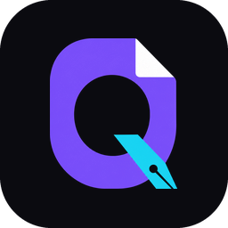

<p align="center"></p>

<h1 align="center">Quintess</h1>

<p align="center"><a href="https://quintess.cc">quintess.cc</a> · <a href="https://github.com/bhanright/quintess/releases/latest">Download for Windows and Linux</a> · <a href="docs/USER_GUIDE.md">User guide</a></p>

A free, open-source, private PDF reader and editor for Windows and Linux. Edit text, sign, redact, fill forms and automate, all on your own computer. No account, no uploads, works offline.

## What it does

- **Read**: tabs, split view, thumbnails, bookmarks, search across a document or a whole folder, night reading, a command palette (Ctrl+K) for every command.
- **Edit text**: change any line or paragraph. Paragraphs re-wrap at their width and alignment, mixed styles (bold, italic, color, underline, strikethrough) carry through edits, and new text is drawn in the document's own font when it can be. A live preview shows what will move before you apply.
- **Comment and mark up**: highlights, notes, text boxes, shapes, freehand ink, stamps and links.
- **Pages**: organize by drag and drop, rotate, insert, extract, split, merge, crop, resize, several pages per sheet, page labels.
- **Forms**: fill, create, detect fields automatically, import and export data, and fill one copy per row of a spreadsheet (CSV, Excel, OpenDocument).
- **Redact for real**: text, pictures and shapes under the boxes are removed from the file, then the rest of the file is checked for the removed text (properties, comments, fields, attachments, hidden entries, earlier versions), with a report of anything that couldn't be checked.
- **Sign and protect**: digital signatures (later edits are saved on top, keeping the signed revision intact), verification, AES-256 encryption and permissions.
- **Scans and codes**: offline OCR makes scanned pages searchable; QR codes on pages are read and opened safely.
- **Convert**: export to Word, Markdown, HTML, text and images; compare two versions; reduce file size; accessibility fixes; PDF/A.
- **Automate**: record your steps as an action, run it on many files, or watch a folder. The same `quintess` program is a full command-line tool that does nearly everything the app does (`quintess merge a.pdf b.pdf -o both.pdf`; `quintess report.pdf` opens the app).
- **Languages**: text in any script, including shaped Hindi and other Indic scripts, Arabic and Hebrew.

The built-in guide (press **F1** in the app, or read [docs/USER_GUIDE.md](docs/USER_GUIDE.md)) explains the tools, common workflows and their limits.

## Install

### Windows

Download the installer from the [releases page](https://github.com/bhanright/quintess/releases) and run it. It installs for your user account only (no administrator rights needed) offers Quintess for opening PDFs without changing your default, and puts the `quintess` command on your PATH.

### Linux

64-bit Linux with glibc 2.35 or later (Ubuntu 22.04, Debian 12, Fedora 36, Mint 21 and newer). Download a package from the [releases page](https://github.com/bhanright/quintess/releases); each has a `.sha256` file to check it with `sha256sum -c`.

Debian, Ubuntu, Mint and other apt systems:

```sh
sudo apt install ./quintess_<version>_amd64.deb
```

(`sudo dpkg -i quintess_<version>_amd64.deb` works too, followed by `sudo apt -f install` if it reports missing libraries.) Remove it with `sudo apt remove quintess`.

Any distribution, with the tarball:

```sh
tar -xzf quintess-<version>-linux-x86_64.tar.gz
cd quintess-<version>-linux-x86_64
./install.sh               # for you, into ~/.local
sudo ./install.sh --system # or for everyone, into /opt/quintess
```

Remove it with `~/.local/lib/quintess/uninstall.sh` (or `sudo /opt/quintess/uninstall.sh`). The tarball needs `libspeechd2` (Fedora: `speech-dispatcher-libs`); `install.sh` names anything missing.

AppImage, nothing to install:

```sh
chmod +x Quintess-<version>-x86_64.AppImage
./Quintess-<version>-x86_64.AppImage            # the app
./Quintess-<version>-x86_64.AppImage --help     # the command-line tool
```

It needs FUSE to mount itself (`libfuse2` or `fuse3`, present on most desktops); without it, run it with `--appimage-extract-and-run`. Tools such as Gear Lever or AppImageLauncher add it to the applications menu.

Flatpak, in a sandbox:

```sh
flatpak install --user Quintess-<version>-x86_64.flatpak
flatpak run cc.quintess.Quintess
```

It needs Flatpak and the Flathub remote (`flatpak remote-add --user --if-not-exists flathub https://dl.flathub.org/repo/flathub.flatpakrepo`), from which it fetches the freedesktop runtime. Inside the sandbox it reaches your Documents and Downloads folders, and any file you pick in a dialog or drop on the window; scanning and converting with LibreOffice or Chrome don't work there (see the guide).

The .deb and the tarball put Quintess in the applications menu and under "Open with" for PDFs, with the command `quintess` (the app, or the command-line tool when followed by a command). Optional, per feature: `cups-client` (printing), `sane-utils` (scanning), `speech-dispatcher` (read aloud), LibreOffice (converting Office files), `xdg-utils` (opening links), `zenity` (file dialogs without a desktop portal), `fonts-liberation` (stand-in fonts when editing text). On Linux there is no certificate store to sign from (use a .pfx/.p12 file), no Microsoft Office conversion and no self-update; see [Installing on Linux](docs/USER_GUIDE.md#installing-on-linux) in the guide.

## Privacy

Quintess never sends your documents anywhere. It goes online only when you ask: checking for updates (off unless you turn it on), and opening links you choose to open.

## Building from source

See [docs/BUILDING.md](docs/BUILDING.md). In short: Rust, PDFium from pdfium-binaries in `vendor/pdfium` (Windows) or `vendor/pdfium-linux` (Linux), then `cargo build -j 6`. `python3 tools/package_linux.py` makes the Linux packages (with `--appimage`, the AppImage too), and `installer/linux/flatpak/build-bundle.sh` the Flatpak bundle from the tarball.

## License

Quintess is licensed under either of [MIT](LICENSE-MIT) or [Apache-2.0](LICENSE-APACHE), at your option. It is built on PDFium (BSD), about 400 open-source Rust libraries and the ocrs recognition models (CC BY-SA 4.0); see [licenses/THIRD-PARTY-NOTICES.txt](licenses/THIRD-PARTY-NOTICES.txt).
